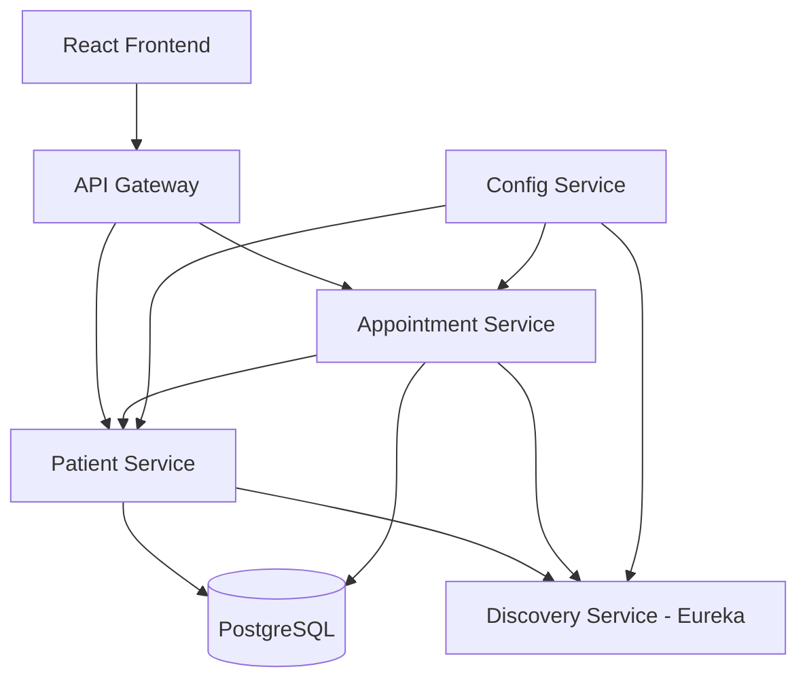

# MediCare

MediCare is a medical cabinet management application developed as a personal learning project. My main goal was to practice building a microservices architecture and applying DevOps practices throughout the development process.

The application provides basic tools for managing patients, appointments, medical certificates and prescriptions.

## About the Project

The project is divided into several independent services that communicate with each other. It also includes a React frontend and a PostgreSQL database.

The main features include:

- Patient management
- Appointment management
- Medical certificates and prescriptions
- Dashboard with application statistics

## Architecture

The application follows a microservices architecture using Spring Boot and Spring Cloud.



### Backend Services

| Service | Port | Responsibility |
|---|---:|---|
| Patient Service | 8081 | Manages patient information |
| Appointment Service | 8082 | Manages appointments, certificates and prescriptions |
| Discovery Service | 8761 | Service registration and discovery using Eureka |
| Config Service | 9999 | Centralized configuration |
| Gateway Service | 8888 | Entry point for frontend requests |

## Technologies Used

**Backend**
- Java 21
- Spring Boot
- Spring Cloud
- Spring Cloud Gateway
- Netflix Eureka
- Spring Cloud Config
- Maven

**Frontend**
- React
- JavaScript
- Vite
- Nginx

**Database**
- PostgreSQL

**DevOps**
- Docker
- Docker Compose
- GitHub Actions
- GitHub Container Registry (GHCR)

## DevOps Implementation

I used this project to get practical experience with containerization and CI/CD.

### Docker

Each backend microservice has its own Dockerfile. The frontend is also containerized using a multi-stage Docker build.

Docker Compose is used to run the different services and the database together.

### CI/CD with GitHub Actions

A GitHub Actions workflow automates the build and verification process whenever code is pushed to the `main` branch or a pull request is created.

The pipeline includes:

1. **Backend:** Builds and verifies all five Spring Boot microservices using Maven.
2. **Frontend:** Installs dependencies and builds the React application.
3. **Docker images:** After the backend and frontend checks succeed on pushes to `main`, Docker images are built and published to GitHub Container Registry.

Images are published with two tags:
- `latest`
- The corresponding Git commit SHA

This makes the images available in GHCR and allows specific versions to be identified by their commit.

## Project Structure

```text
MediCare-project/
│
├── backend/
│   ├── patient-service/
│   ├── appointment-service/
│   ├── discovery-service/
│   ├── config-service/
│   ├── gateway-service/
│   ├── init-db/
│   ├── docker-compose.yml
│   └── .env.example
│
├── medic-frontend/
│   ├── src/
│   ├── Dockerfile
│   └── package.json
│
├── .github/
│   └── workflows/
│       └── ci.yml
│
└── README.md
```

## Running the Project Locally

### Prerequisites

- Docker Desktop
- Git

### 1. Clone the repository

```bash
git clone https://github.com/samia-dev5113/MediCare-project.git
cd MediCare-project
```

### 2. Configure environment variables

Copy the example environment file:

```powershell
Copy-Item backend/.env.example backend/.env
```

Update `backend/.env` with your local configuration.

### 3. Start the application

From the project root, run:

```powershell
cd backend
docker compose up -d --build
```

Docker Compose will build the images and start the application services.

### 4. Access the application

| Component | URL |
|---|---|
| Frontend | http://localhost:3000 |
| API Gateway | http://localhost:8888 |
| Eureka Dashboard | http://localhost:8761 |
| Config Server | http://localhost:9999 |

PostgreSQL is exposed on port `5433`.

### 5. Stop the application

```powershell
docker compose down
```

To also remove the database volume and its stored data:

```powershell
docker compose down -v
```

## What I Learned

Working on this project helped me gain practical experience with:

- Designing and organizing a microservices architecture
- Building REST APIs with Spring Boot
- Service discovery and centralized configuration
- Communication between microservices
- Containerizing applications with Docker
- Managing multiple services with Docker Compose
- Automating builds and verification with GitHub Actions
- Building and publishing Docker images to GHCR

## Future Improvements

- Add Kubernetes orchestration
- Improve automated testing
- Extend the CI/CD pipeline with a deployment stage

---

This is a personal learning project focused on improving my understanding of microservices architecture and DevOps practices through hands-on development.